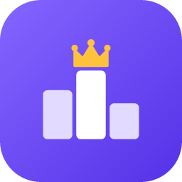
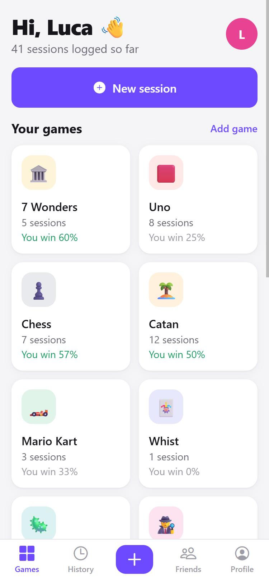
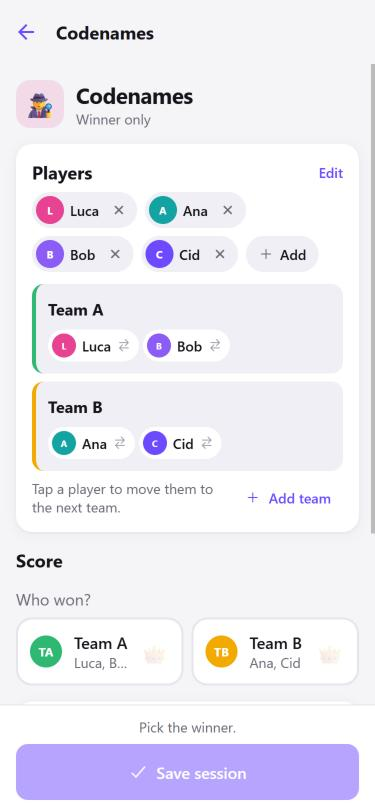
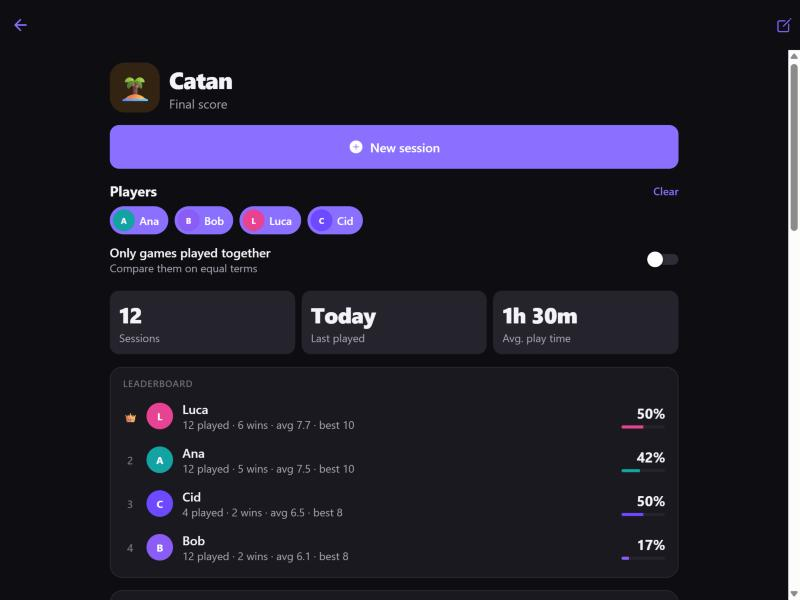
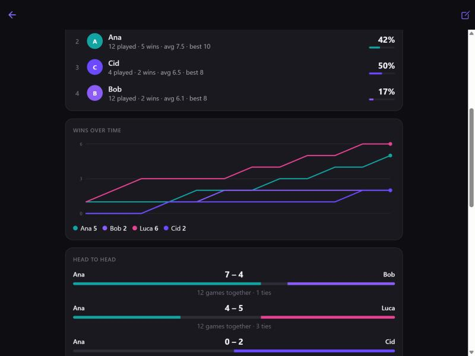

<p align="center">
  
</p>

<h1 align="center">Bragboard</h1>
<p align="center"><b>Keep score of every game night. Earn the bragging rights.</b><br/>
A score keeper and stats tracker for any board, card, party or video game, on Android, iPhone and the web, synced through your own server.</p>

<p align="center">
  
  &nbsp;
  
</p>
<p align="center">
  
  
</p>

## Features

- **Any game, its own scoring.** Pick a template (Catan, Whist, Uno, 7 Wonders, Chess, Codenames, Secret Hitler, Mario Kart, Pandemic and 25 more) or set up your own:
  | Scoring | For games like | Options |
  |---|---|---|
  | Final score | Catan, Scrabble | lowest wins, teams |
  | Rounds | Uno, Rummy, Hearts | play to a target score, lowest wins, teams |
  | Bids & tricks | Whist, Oh Hell | points for exact bid, per trick, penalty per trick off |
  | Score sheet | 7 Wonders, Yahtzee, Ticket to Ride | your own categories (negative values allowed) |
  | Finishing order | Mario Kart, Poker | tap players in the order they finished |
  | Winner only | Chess, Codenames, Secret Hitler | draws, teams (with their own names, e.g. Liberals vs Fascists) |
  | Co-op | Pandemic | shared win/loss, optional team score |
  All games can also track play time and notes.
- **Fast.** New session in 3 taps: **+** → game → scores → Save. Players (and teams) of the last game are pre-filled, and *Play again* starts a rematch. Stats are 2 taps away: Games → game.
- **Statistics per game, for the players you pick.** Leaderboard (wins, win rate, average and best score), wins over time chart, head-to-head, records (most wins, longest streak, best score, biggest win). Toggle *only games played together* to compare people fairly.
- **Profiles.** Every session you are part of shows up on your profile with your totals, win rate, best streak, favourite game and per-game stats. Other people's profiles show your games together and *you vs them*.
- **Friends.** Add people by username, pick them in one tap. See who added you and people you played with.
- **Guests.** Add someone without an account by name; when they sign up later, link the guest to their account and their history moves to their profile.
- **Never lose a game in progress.** Unfinished sessions are saved on the device; *Continue Whist* is waiting on the home screen.
- **Synced everywhere.** One account on web, Android and iPhone. Changes show up live on other devices; the app opens instantly from a local cache and works read-only offline.
- Light and dark mode, phone/tablet/desktop layouts.

## How it works

```
 Android app ─┐
 iPhone app  ─┼── HTTPS ──>  Cloudflare Tunnel / Tailscale Funnel ──> Raspberry Pi
 Web / PWA   ─┘                                                       └─ Docker: PocketBase
                                                                          ├─ REST + realtime API
                                                                          ├─ accounts & login
                                                                          ├─ SQLite database (pb_data/)
                                                                          ├─ admin panel  (/_/)
                                                                          └─ the web app  (/)
```

- **App** (`client/`): one [Expo](https://expo.dev) / React Native codebase that builds the Android app, the iPhone app and the website.
- **Server** (`server/`): [PocketBase](https://pocketbase.io), a single small program that gives us login, the database, a live-update API, backups and an admin panel. The schema and the security rules are in [`server/pb_migrations`](server/pb_migrations). It also serves the web app, so there is one address for everything.
- **Hosting**: a Docker container on your Raspberry Pi, published to the internet with a free tunnel (no router port forwarding, works behind any home connection).

Why this setup and what it costs: see [docs/ARCHITECTURE.md](docs/ARCHITECTURE.md).

| | Cost |
|---|---|
| Server on your Raspberry Pi | free (≈ 3 W of power) |
| Public HTTPS via Tailscale Funnel | free |
| …or via Cloudflare Tunnel with your own domain | free + domain (≈ €10/year) |
| Web app / iPhone "Add to Home Screen" app | free |
| Android APK (sideload) | free |
| Google Play Store | $25 once (optional) |
| Apple App Store | $99/year (optional) |

## Get started

### 1. Run it locally (Windows, macOS, Linux)

You need [Node.js 22+](https://nodejs.org).

```bash
# server: download PocketBase 0.40.6 for your OS from
# https://github.com/pocketbase/pocketbase/releases/tag/v0.40.6 and unzip it into server/
cd server
./pocketbase serve            # http://127.0.0.1:8090, schema is applied automatically
./pocketbase superuser upsert you@example.com YourAdminPassword   # in a second terminal
```

```bash
# app
cd client
npm install
npm run web        # opens http://localhost:8081, talks to http://127.0.0.1:8090 (see client/.env.development)
```

Optional demo data (4 users, 8 games, 40 sessions, only for a local server):

```bash
PB_ADMIN_EMAIL=you@example.com PB_ADMIN_PASSWORD=YourAdminPassword node --experimental-strip-types server/scripts/seed-demo.mjs
```

On your phone: install **Expo Go**, run `npx expo start` in `client/`, scan the QR code. Set `EXPO_PUBLIC_API_URL` in `client/.env.development` to your computer's LAN address (for example `http://192.168.1.20:8090`) so the phone can reach the server.

### 2. Put the server on your Raspberry Pi

Short version (full step-by-step guide: [docs/DEPLOY_PI.md](docs/DEPLOY_PI.md)):

```bash
# on the Pi (64-bit Raspberry Pi OS)
curl -fsSL https://get.docker.com | sh
git clone https://github.com/tompealuca/bragboard.git && cd bragboard/deploy
cp .env.example .env
docker compose up -d
docker compose exec bragboard /pb/pocketbase superuser upsert you@example.com YourAdminPassword --dir=/pb/pb_data
```

Then make it reachable from anywhere with Tailscale Funnel (free, no domain) or Cloudflare Tunnel (your domain). Every push to `main` builds a new image (GitHub Actions); `deploy/update.sh` pulls it.

### 3. Get the apps

- **Web**: open your server address in any browser.
- **iPhone**: open the address in Safari → Share → *Add to Home Screen*. It runs full screen like an app, free.
- **Android**: build an APK with one command (free) and install it, or publish to Google Play.
- **Native iPhone app**: possible with an Apple Developer account.

Step by step: [docs/MOBILE_APPS.md](docs/MOBILE_APPS.md).

## Project structure

```
client/                Expo app (Android, iOS, web)
  src/app/             screens (file-based routes)
  src/components/      UI kit, score inputs, stats widgets
  src/lib/scoring.ts   scoring engine: input -> totals, ranks, winners
  src/lib/stats.ts     statistics engine
  src/lib/templates.ts ready-made games
server/
  pb_migrations/       database schema + access rules
  tests/               API access rule tests
  scripts/             demo data seeder
deploy/                docker compose, update script
Dockerfile             PocketBase + web app image (amd64 + arm64)
docs/                  deployment, mobile and architecture guides
```

## Tests

```bash
cd client && npm test && npx tsc --noEmit     # scoring + stats engine, types
node server/tests/access-rules.mjs            # against a running local server
```

CI runs both on every push.

## Ideas for later

Profile pictures, Google / Apple sign-in, CSV export, game night "tournaments" across games, per-round notes, offline saving of finished sessions (queued upload).

## License

MIT, see [LICENSE](LICENSE).
